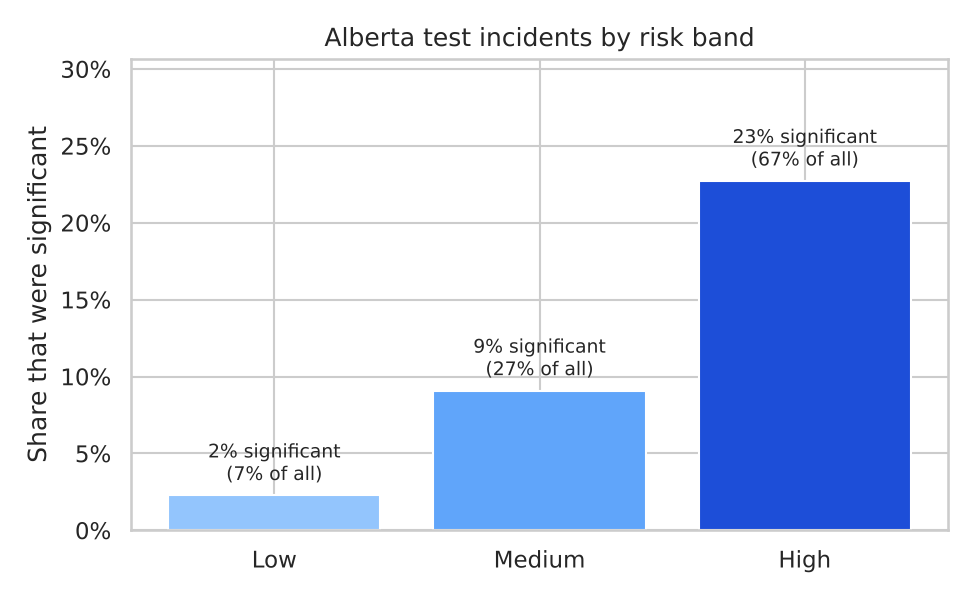
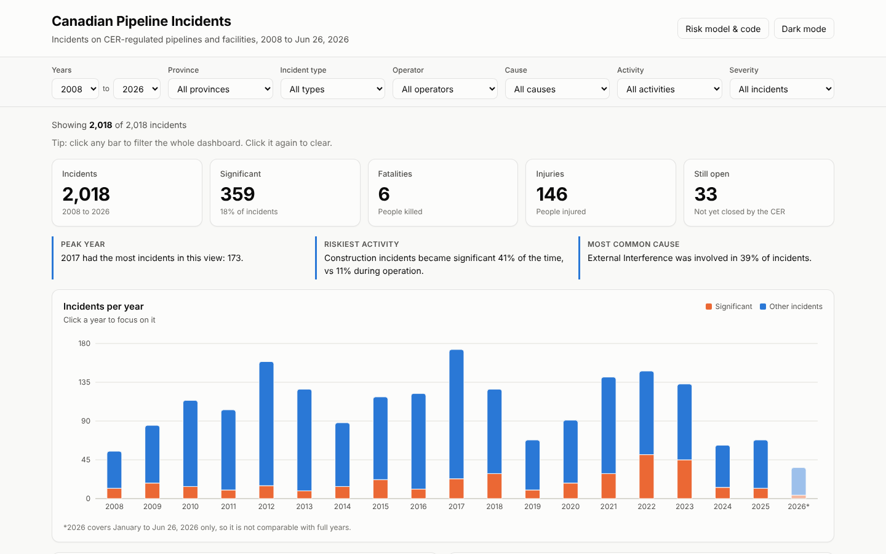
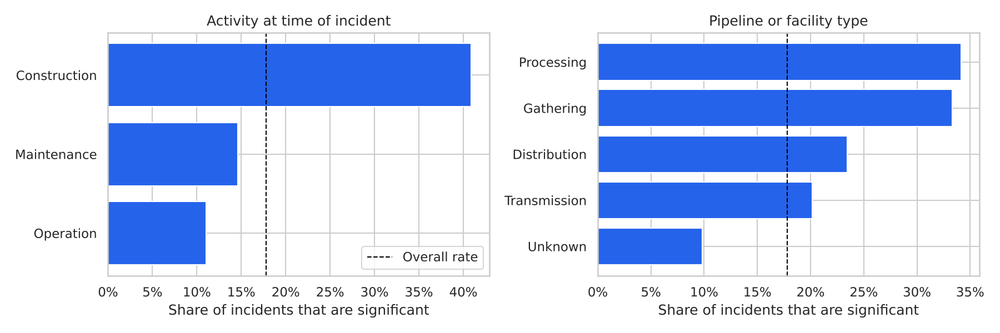
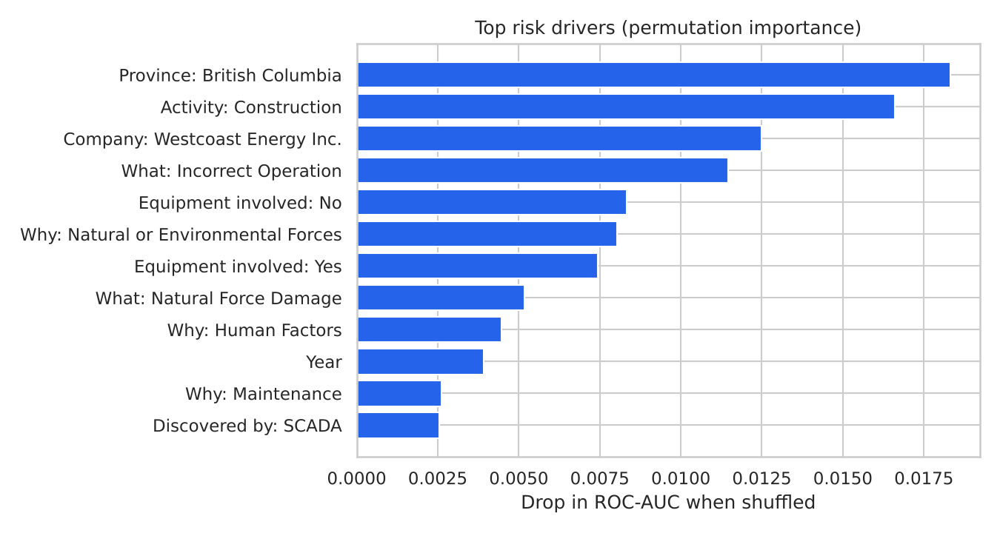

# Pipeline Incident Risk Scoring, with a Focus on Alberta

A machine learning model that scores incidents on federally regulated Canadian pipelines by their risk of becoming **significant** (fatality, serious injury, fire, explosion or major release), using only information about the incident's **cause and setting**. Built in Python with scikit-learn on open data from the Canada Energy Regulator (CER).

Alberta reports more incidents than any other province (708 of 2,018), so the analysis pays special attention to how the model performs there.

## Key results

| | Value |
|---|---|
| Test ROC-AUC (random forest) | **0.84** |
| Test PR-AUC | **0.60** (random guessing: 0.18) |
| Recall at chosen threshold | **75%** (54 of 72 significant incidents flagged) |
| ROC-AUC on Alberta incidents only | **0.82** |
| Alberta high-risk band | **23%** significant vs. **2%** in the low-risk band |



On held-out Alberta incidents, the top third of risk scores contained two-thirds of the significant incidents, so the score could help prioritize follow-up and inspections.

## Interactive dashboard

The [`dashboard/`](dashboard) folder has a React dashboard for exploring the same data by year, province, operator, cause and incident type.



## Data

[Incidents at CER-Regulated Pipelines and Facilities](https://open.canada.ca/data/en/dataset/fd17f08f-f14d-433f-91df-c90a34e1e9a6), Canada Energy Regulator, Open Government Licence – Canada. 2,018 incidents from 2008 to 2026, 102 columns. 17.8% of incidents are significant (14.3% in Alberta).



Incidents during **construction** become significant 41% of the time, nearly four times the rate during normal operation (11%).

## Approach

1. **Avoided target leakage.** Columns that describe the outcome (incident type, volume released, rupture, injuries, evacuations, emergency level, investigation type) are part of how "significant" is defined, so they were excluded.
2. **Built features from cause and setting:** what happened and why (multi-label cause categories), activity at the time, facility type, land use, province, how the incident was discovered, equipment involvement, operator and year (70 features).
3. **Compared three class-balanced models** with stratified 5-fold cross-validation on an 80/20 split: logistic regression, random forest and gradient boosting. The random forest performed best (CV ROC-AUC 0.85).
4. **Chose a safety-first threshold on training data only** (out-of-fold predictions) to catch at least 75% of significant incidents, then checked it on the test set.
5. **Explained the model** with permutation importance, and grouped Alberta test incidents into low, medium and high risk bands.

| Model | CV ROC-AUC | Test ROC-AUC | Test PR-AUC |
|---|---|---|---|
| Logistic regression | 0.80 | 0.79 | 0.55 |
| **Random forest** | **0.85** | **0.84** | **0.60** |
| Gradient boosting | 0.83 | 0.82 | 0.58 |

## What drives the risk



Construction activity, incorrect operation, natural or environmental forces, equipment involvement, province and operator carry the most signal. These are associations, not proof of cause.

## Limitations and next steps

- The data only contains incidents, not pipelines without incidents, so this model scores **incident severity risk**, not the chance that a given pipeline segment will have an incident.
- Older records were migrated with many unknown fields, and reporting rules have changed over time.
- The test set is small (404 incidents, 132 in Alberta), so results will vary with a different split.
- **Next:** join pipeline asset data (length, age, diameter, material, pressure) to model incident likelihood per kilometre for true segment-level risk scores, validate on the most recent years, and calibrate the probabilities.

## Run it yourself

```bash
pip install -r requirements.txt
jupyter notebook pipeline_incident_risk_model.ipynb
```

## Tools

Python, pandas, scikit-learn, matplotlib, seaborn, Jupyter
